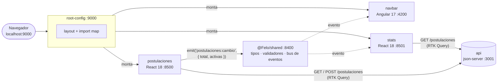

# JobTrack

Aplicación para registrar y seguir postulaciones laborales, construida con
microfrontends (MFE) sobre [single-spa](https://single-spa.js.org/): un
navbar en Angular y dos MFE en React con Redux Toolkit, orquestados por un
root-config y comunicados por eventos tipados.

## Capturas

![JobTrack en tema claro, ruta Postulaciones. Barra de navegación oscura con la marca JOBTRACK PRO, el botón de tema, los enlaces Inicio y Postulaciones (subrayados) y el contador "Activas: 4 / 6". Debajo, el bloque "Resumen (Stats MFE)" con dos tarjetas: Total 6 y Activas 4. Luego "Mis Postulaciones (React MFE)": un formulario con los campos Empresa y Cargo y el botón Crear Postulación, y una tabla con columnas Empresa, Cargo, Estado y Fecha con 6 postulaciones de ejemplo, 4 con la etiqueta azul "postulado" y 2 con la etiqueta roja "rechazado".](docs/img/jobtrack-claro.png)


## Por qué existe

- **Aprender haciendo.** single-spa y Redux Toolkit (RTK Query) en un
  proyecto completo, con los problemas reales que aparecen al integrar
  varios frameworks: comunicación entre MFE, estilos que chocan, caché
  duplicada, CSP.
- **Usarla de verdad.** Es la herramienta con la que registro mis propias
  postulaciones. Los datos reales viven solo en mi máquina; el repo trae
  datos ficticios en `api/db.example.json`.

## Arquitectura



- **root-config** define el layout (`microfrontend-layout.html`) y el import
  map; single-spa y React se cargan una sola vez desde CDN, y los MFE que
  los usan los comparten.
- **postulaciones** lista y crea postulaciones. Cuando su lista cambia,
  emite `postulaciones:cambio` con `{ total, activas }`.
- **stats** pide sus propios datos y, al recibir el evento, invalida su
  caché para recalcular.
- **navbar** muestra el contador de activas sobre el total a partir del
  evento; no llama a la API. Hasta recibir el primer evento muestra
  "sin dato" en vez de 0.

| Pieza | Tecnología | Puerto | Función |
| --- | --- | --- | --- |
| `root-config` | single-spa + single-spa-layout | 9000 | Orquestador: layout, rutas, import map y CSP |
| `shared` | módulo utilitario de single-spa (TypeScript) | 8400 | Contrato del dominio: tipos, validadores y bus de eventos |
| `navbar` | Angular 17 + single-spa-angular | 4200 | Navegación, tema claro/oscuro y contador de activas / total |
| `postulaciones` | React 18 + Redux Toolkit (RTK Query) | 8500 | Lista y formulario de postulaciones |
| `stats` | React 18 + Redux Toolkit (RTK Query) | 8501 | Resumen: total y activas |
| `api` | json-server (solo desarrollo) | 3001 | API REST sobre un archivo JSON |

## Cómo levantarlo

### Requisitos

- [Node.js](https://nodejs.org/) 22 (probado con 22.23.2).
- [pnpm](https://pnpm.io/installation) 11: `npm install -g pnpm@11`.
  Es obligatorio: cada proyecto tiene su `pnpm-lock.yaml` y el campo
  `packageManager` fija la versión exacta (pnpm cambia a ella solo si
  tienes otra). npm no funciona con estas `node_modules`.
- Chrome o Chromium, solo para los tests de navbar.

Los comandos usan `pnpm --dir <carpeta>` y se ejecutan desde la raíz del
repo, así que funcionan igual en Windows (PowerShell o cmd), macOS y Linux.

### 1. Instalar

Cada carpeta es un proyecto independiente con sus propias dependencias:

```sh
pnpm --dir api install
pnpm --dir shared install
pnpm --dir navbar install
pnpm --dir postulaciones install
pnpm --dir stats install
pnpm --dir root-config install
```

### 2. Arrancar

Cada servicio en su propia terminal, en este orden:

```sh
pnpm --dir api api:demo                     # API con datos ficticios
pnpm --dir shared start                     # primero: los MFE lo importan
pnpm --dir navbar serve:single-spa:navbar
pnpm --dir postulaciones start
pnpm --dir stats start
pnpm --dir root-config start
```

`shared` va primero porque stats, postulaciones y navbar lo cargan en
tiempo de ejecución desde el import map: si no responde, esos MFE no se
montan.

Luego abre <http://localhost:9000/postulaciones>.

`api:demo` sirve `api/db.example.json`. Los cambios que hagas en la app se
guardan en ese archivo; para volver a los datos originales:
`git checkout api/db.example.json`.

## Tests

```sh
pnpm --dir shared test
pnpm --dir root-config test
pnpm --dir postulaciones test
pnpm --dir stats test
pnpm --dir navbar test
```

- `shared`, `root-config`, `postulaciones` y `stats`: Jest 27; los MFE de
  React con Testing Library, consultando por rol y texto visible.
- `navbar`: Karma + Jasmine en Chrome headless.
- root-config incluye un test que recalcula los hashes de la CSP y falla
  si un script en línea cambió sin actualizar su hash.

Revisión de tipos en los MFE de React:

```sh
pnpm --dir postulaciones exec tsc -p . --noEmit --emitDeclarationOnly false
```

(ver [Limitaciones conocidas](#limitaciones-conocidas) por los errores en
`node_modules`).

## Decisiones de arquitectura

- **Un store de Redux por MFE, sin store global.** Compartir un store
  volvería a acoplar los MFE y rompería el despliegue independiente. El
  costo aceptado es que stats y postulaciones piden la misma lista cada uno.
  → [ADR-001: flujo de datos entre MFE](docs/adr/adr-001-flujo-datos-mfe.md)
- **Eventos tipados.** `@Felo/shared` define el contrato `Eventos`, que
  asocia cada nombre (`postulaciones:cambio`) con su payload exacto. `emit`
  y `on` son genéricos sobre ese contrato, así que TypeScript rechaza un
  evento mal escrito o un payload incorrecto. Por debajo es un
  `CustomEvent` del navegador, sin librerías.
- **shared es el contrato del dominio, no un lugar para compartir todo.**
  Contiene tipos, constantes, validadores puros y el bus de eventos.
  Nunca estado, componentes de UI ni llamadas a la API. Las respuestas de
  la API se validan con `filtrarPostulaciones` antes de entrar al store.
  → [ADR-002: rol de @Felo/shared](docs/adr/adr-002-rol-shared.md)
- **Aislamiento de CSS.** Cada MFE compila su propio Tailwind con
  `preflight` desactivado (el reset base no se carga varias veces) e
  `important: '.jt-<mfe>'`, que limita sus utilidades a su contenedor. Así
  las clases de un MFE no pisan las de otro. El tema claro/oscuro se
  define una vez, con variables CSS en root-config.
- **CSP sin `'unsafe-inline'` en scripts.** Los tres scripts en línea de
  `index.ejs` (el del tema inicial, el que importa root-config y el import
  map) se permiten por hash `sha256`. Un test verifica que los hashes
  coincidan con el contenido.
- **Accesibilidad (WCAG 2.2 AA).** Contraste medido en ambos temas (texto
  ≥ 4.5:1, texto grande y bordes ≥ 3:1). Ningún MFE muestra 0 cuando no
  tiene el dato. postulaciones distingue carga (`role="status"`), error
  (`role="alert"`, con botón para reintentar) y lista vacía. stats
  distingue carga y error (`role="alert"`). navbar muestra "sin dato"
  hasta recibir el evento. Un solo `h1` por ruta, labels en el formulario,
  foco visible y `aria-current` en la navegación. La transición del tema se
  desactiva con `prefers-reduced-motion`.

## Limitaciones conocidas

- **TypeScript 4.9 frente a Redux Toolkit 2.** Los MFE de React usan
  TypeScript 4.9 (navbar usa el 5.4 que pide Angular 17). RTK 2 usa
  `NoInfer`, que necesita TypeScript 5.4+. `tsc` muestra 6 errores dentro de
  `node_modules` en postulaciones y stats (y shared falla en
  `@types/node`). El código de `src/` no tiene errores. La actualización
  de TypeScript está pendiente.
- **single-spa en dos versiones.** root-config, shared, postulaciones y
  stats declaran single-spa `^5.9.3` en su `package.json` (navbar,
  `>=4.0.0`), pero el import map de root-config carga
  single-spa 6.0.3 desde jsdelivr, que es la que corre en el navegador.
  Falta alinearlas.
- **Jest 27.** Es la versión de la plantilla de create-single-spa; migrar a
  Jest 29 o Vitest va junto con la actualización de TypeScript.
- **Tipos de shared copiados a mano.** Cada MFE declara `@Felo/shared` en
  su `declarations.d.ts` con una copia de los tipos; si cambia el
  contrato, hay que actualizar las copias. Pendiente: generarlas desde
  shared.
- **CSP:** `script-src` todavía permite cualquier origen `https:`; falta
  restringirlo a los CDN usados (cdn.jsdelivr.net, esm.sh). Además, los
  overrides de import-map-overrides quedan bloqueados, porque cambian el
  import map y con él su hash.
- **CSS global residual:** `.badge` y sus estados están en root-config,
  aunque solo los usa postulaciones.
- **navbar** todavía usa inyección por constructor y no aplica
  `ChangeDetectionStrategy.OnPush`, como piden las reglas del proyecto.
- **json-server es solo para desarrollo local.** No hay autenticación ni
  backend de producción, y no debe exponerse a la red.

## Cómo se desarrolló

Lo desarrollé con agentes de IA en dos roles: uno escribe los cambios y
otro los revisa. Ninguno trabaja sin reglas: [`AGENTS.md`](AGENTS.md)
define la arquitectura, las versiones permitidas, las convenciones y lo
que nunca se hace (por ejemplo, tocar los datos reales). Es el mismo
archivo que leen todos los agentes.

Cada paso pasó por mí: plan aprobado antes de tocar código, cambios
pequeños con su test, y verificación manual en el navegador (Network,
contraste con el inspector, teclado y lector de pantalla NVDA) antes del
commit. Las decisiones con alternativas reales quedaron como ADR en
[`docs/adr/`](docs/adr/).

## Licencia

[MIT](LICENSE) © 2026 Felipe Peñaloza
